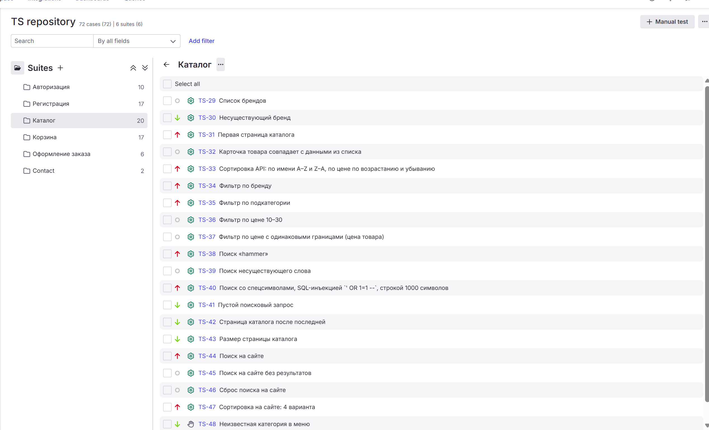

# Toolshop QA — тестирование интернет-магазина

[](https://github.com/alena227/toolshop-qa/actions/workflows/tests.yml)

Полный цикл тестирования учебного интернет-магазина
[Practice Software Testing (Toolshop)](https://practicesoftwaretesting.com):
от анализа требований и исследовательского тестирования до автотестов API и UI с CI.

**Стек:** Python · pytest · requests · Playwright · Allure · jsonschema · Postman · Newman · Docker · GitHub Actions

## Результаты

Итоговый документ — [отчёт о тестировании](docs/test-report.md).

- **72 тест-кейса** по техникам тест-дизайна в **Qase**, **88% автоматизировано** — копия в [test-cases.md](docs/test-cases.md)
- **Найдено 48 дефектов**, из них **3 критичных** и **22 серьёзных** (Major) — полный список в [журнале дефектов](bugs/bug-log.md)
- **102 автотеста:** 78 API (pytest + requests) и 24 UI (Playwright, Page Object), включая сквозной сценарий покупки: поиск → корзина → вход → адрес → оплата → номер заказа
- **Коллекция Postman** на 12 запросов и 23 проверки (цепочки запросов, проверка JSON-схемы, негативные кейсы), запускается через **Newman** в CI
- **8 дефектов в версии магазина без намеренных багов**, 7 из них найдены при написании автотестов — подробнее ниже
- **7 подробных баг-репортов** в [GitHub Issues](https://github.com/alena227/toolshop-qa/issues): шаги воспроизведения, ожидаемый и фактический результат, скриншоты, запросы и ответы API
- **8 вопросов к требованиям** по документации API — [requirements-issues.md](docs/requirements-issues.md)
- **CI на каждый push и ежедневно:** магазин поднимается в Docker с нуля прямо в GitHub Actions, полный цикл занимает меньше 5 минут

### Тест-кейсы в Qase

72 тест-кейса в 6 сьютах: у каждого приоритет, серьёзность, тип (позитивный или негативный),
слой (API или E2E) и отметка об автоматизации. Проект приватный, поэтому здесь — скриншот.



### Дефекты в версии без намеренных багов

Эти дефекты найдены в **чистой** версии магазина, где намеренных багов нет. Большую часть
нашли автотесты: тесты на граничные
значения и классы эквивалентности поймали то, что при ручной проверке легко пропустить.
Каждый тест помечен `xfail` со ссылкой на дефект: он описывает правильное поведение и сообщит,
когда баг исправят.

| Дефект | Как найден | Severity |
|---|---|---|
| Верхняя граница возраста 93 года вместо 75: объект даты изменяется при вычислении второй границы | граничные значения: 75 лет + 1 день, 92 года | Major |
| Сервер принимает email в любом формате: без `@`, без домена, с пробелом | классы эквивалентности невалидного email | Major |
| Лимит «не больше 99 штук» обходится повторным добавлением: можно набрать 297 штук | граничное значение 99 + сценарий «добавить ещё 1» | Major |
| Если сервер отклоняет заказ, сайт молчит: ни подтверждения, ни ошибки | сквозной UI-тест покупки, разбор ответов API | Major |
| Регистрация принимает адрес, который оформление заказа потом отклоняет | сквозной UI-тест покупки | Major |
| В день 18-летия регистрация отклоняется | граничное значение: ровно 18 лет | Minor |
| Регистрация отвечает 3–11+ секунд, тесты падали по таймауту | нестабильный тест, замер `--durations` | Minor |
| При ошибке сервера страница регистрации показывает текст `true` вместо сообщения | вручную, причина найдена в коде страницы | Minor |

### Самые серьёзные находки

| Дефект | Severity |
|---|---|
| [После смены пароля в профиле невозможно войти ни с новым, ни со старым паролем](https://github.com/alena227/toolshop-qa/issues/1) | Critical |
| [После сброса пароля невозможно войти, сайт при этом сообщает об успехе](https://github.com/alena227/toolshop-qa/issues/2) | Critical |
| [Заказ оплачивается служебным методом «Errror 304 - Missing Payment Gateway»](https://github.com/alena227/toolshop-qa/issues/4) | Critical |
| [Сортировка по имени и по цене работает в обратную сторону](https://github.com/alena227/toolshop-qa/issues/3) | Major |
| [Итоговая сумма корзины на $0.01 меньше суммы товаров](https://github.com/alena227/toolshop-qa/issues/5) | Major |
| [Регистрация раскрывает подсказку к чужому паролю](https://github.com/alena227/toolshop-qa/issues/6) | Major |
| [Принимается пароль без букв и спецсимволов](https://github.com/alena227/toolshop-qa/issues/7) | Major |

### Проблемы окружения, которые пришлось решить

Отдельно описаны в [docs/notes.md](docs/notes.md): негативные тесты блокировали общий аккаунт,
публичный стенд закрыт защитой Cloudflare от ботов, в CI тесты стартовали раньше, чем магазин был готов,
а на Linux у PHP не было прав на запись кэша. Итог — окружение, которое поднимается с нуля и не зависит
от внешнего стенда.

## Что внутри

```
bugs/                    журнал дефектов и скриншоты
docs/                    тест-план, вопросы к требованиям, заметки, шаблон баг-репорта
pages/                   Page Object для UI-тестов
postman/                 коллекция Postman и окружение для Newman
tests/api/               API-автотесты (pytest + requests)
tests/ui/                UI-автотесты (Playwright)
utils/                   конфиг и API-клиент с логированием в Allure
.github/workflows/       CI: магазин в Docker + прогон тестов на каждый push и раз в день
.github/ISSUE_TEMPLATE/  форма баг-репорта для GitHub Issues
```

## Тестовое окружение

Тесты идут против магазина, поднятого локально в Docker. Публичный стенд для автотестов не подходит:
его UI закрыт защитой от ботов.

```bash
git clone https://github.com/testsmith-io/practice-software-testing.git
cd practice-software-testing
docker compose up -d
docker compose exec -u root laravel-api chown -R www-data:www-data storage bootstrap/cache
docker compose exec laravel-api php artisan migrate:fresh --seed
```

После запуска: сайт — http://localhost:4200, API и Swagger — http://localhost:8091/api/documentation.

Поиск дефектов вёлся вручную на версии с намеренными багами: https://with-bugs.practicesoftwaretesting.com

## Как запустить тесты

```bash
python -m venv .venv
source .venv/bin/activate            # Windows: .venv\Scripts\activate
pip install -r requirements.txt
playwright install chromium
cp .env.example .env                 # Windows: copy .env.example .env
```

В `.env` укажи адреса локального магазина:

```
BASE_URL=http://localhost:4200
API_URL=http://localhost:8091
```

```bash
pytest                               # все тесты
pytest -m smoke                      # только smoke
pytest -m api                        # только API
pytest -m ui --headed                # UI с видимым браузером

allure serve allure-results          # открыть отчёт (нужен Allure CLI)
```

Коллекция Postman (нужен Node.js):

```bash
npx -p newman -p newman-reporter-htmlextra newman run postman/toolshop.postman_collection.json \
  -e postman/local.postman_environment.json -r cli,htmlextra --reporter-htmlextra-export newman-report.html
```

Коллекцию можно и импортировать в Postman: **Import** → файлы из папки `postman/`.

---

## Документы

- [Тест-план](docs/test-plan.md)
- [Тест-кейсы](docs/test-cases.md)
- [Вопросы к требованиям](docs/requirements-issues.md)
- [Журнал дефектов](bugs/bug-log.md) и [баг-репорты](https://github.com/alena227/toolshop-qa/issues)
- [Проблемы окружения и как они решены](docs/notes.md)
- [Отчёт о тестировании](docs/test-report.md)

## Что можно развить дальше

- API-тесты оформления заказа (`/invoices`, `/payment/check`)
- Тесты избранного, профиля и админ-панели
- Замер времени ручного регресса — сейчас в отчёте только оценка
